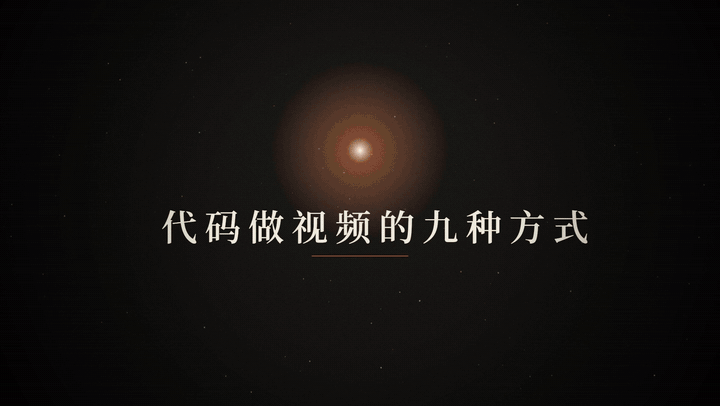
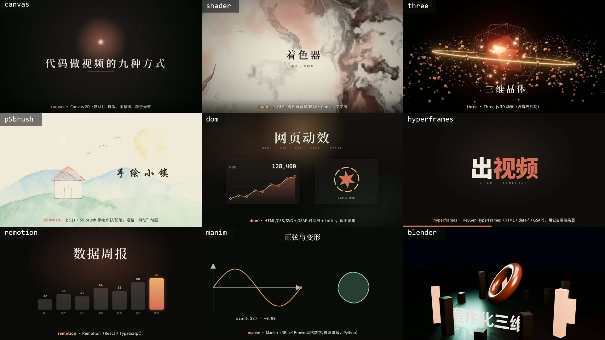
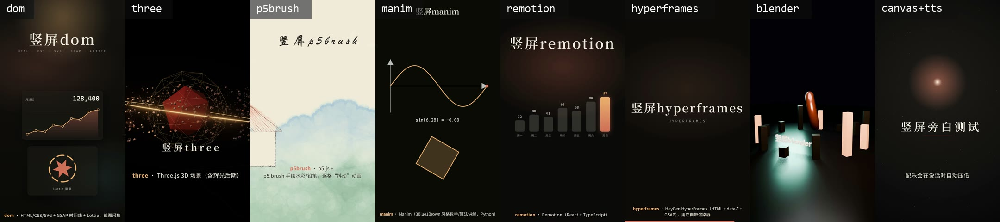
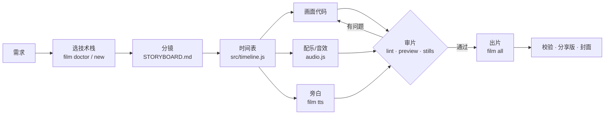

<div align="center">

# code-video

**让任何 AI 大模型用代码做出好看的视频**

一个开放标准的 Agent Skill + `film` 命令行：九种技术栈、代码合成配乐与旁白、逐帧审片、一键出片。
装进 Claude Code、Codex、WorkBuddy 等 Agent，说一句“做一个关于 X 的视频”，就能得到可以直接发布的成片。

[](LICENSE)


[快速开始](#快速开始) · [支持的 Agent](#支持的-agent-与模型) · [九种技术栈](#九种技术栈) · [工作流](#它是怎么工作的) · [命令速查](#film-命令速查) · [English](#english)



</div>

---

## 这是什么

大模型本身不会输出视频，但它很会写代码。code-video 给 AI 一套**完整的“用代码拍片”方法和工具**：

- **方法**：`SKILL.md` + `references/` 详细规定了从需求、分镜、时间表、画面、声音到审片、交付的每一步，以及配色、字号、动效、构图、字幕的审美规范——AI 照着做，出来的片子统一、克制、好看，而不是“能动就行”。
- **工具**：`film` 命令行负责所有脏活——新建项目、浏览器实时预览、旁白合成、时间表检查、逐帧渲染、编码与响度校验、封面/GIF/字幕/分享版。
- **零素材依赖**：画面由代码绘制，配乐和音效由代码合成，旁白用 TTS。不需要素材库，也不需要视频生成模型。



> 上图是九种技术栈各自的 8 秒模板样片，都由 `film new` 一条命令生成、`film all` 一条命令出片。

## 特性

| | |
|---|---|
| 🎬 **九种技术栈** | Canvas 2D、GLSL 着色器、Three.js、p5.brush 手绘、HTML/CSS/SVG/GSAP/Lottie、HyperFrames、Remotion、Manim、Blender——按想要的效果选，也能混用拼接 |
| 🎵 **代码合成声音** | pad / 拨弦 / 低音 / 鼓 + 20 种音效（打字、回车、转场、成功、失败、时钟…），四种调式，按情绪曲线编排；自动校正到 −15 LUFS |
| 🗣️ **AI 旁白 + 自动字幕** | 写一句 `{ t, text }`，`film tts` 用 edge-tts 合成（离线退回系统语音），自动分句出字幕，说话时配乐自动压低 |
| 📐 **任意画幅** | 16:9、9:16 竖屏、1:1、4:3、4K；模板按比例布局，竖屏字幕自动放大并避开平台 UI 区 |
| 🔍 **会审片** | `film stills` 抽帧拼联系表让 AI 逐张检查；`film lint` 检查字幕阅读速度、重叠、旁白冲突、配乐过期 |
| ✅ **会验收** | `film verify` 全量解码校验编码、帧数、响度、真峰值、全黑段，生成报告 |
| 📦 **会交付** | 母版 + 分享版（约 1/10 体积）+ 三种比例封面 + SRT/软字幕 + 预览 GIF |
| 🧩 **开放标准** | 遵循 [Agent Skills](https://agentskills.io) 规范，一份技能装进多个 Agent |



> 同一套模板 `--size 9:16` 直接出竖屏，适合抖音、小红书、视频号、Reels、Shorts。

## 快速开始

### 1. 安装

**Windows**（任选其一）

```powershell
# 一行命令（PowerShell）
irm https://raw.githubusercontent.com/dxawdc/code-video/main/get.ps1 | iex
```

或者下载 [最新 Release](https://github.com/dxawdc/code-video/releases/latest) 的 zip，解压后双击 **`一键安装.cmd`**（需要 Manim 和 Blender 就双击 `一键安装（完整版，含Manim和Blender）.cmd`）。

**macOS / Linux**

```bash
curl -fsSL https://raw.githubusercontent.com/dxawdc/code-video/main/get.sh | bash
# 完整版（含 Manim + Blender）：
curl -fsSL https://raw.githubusercontent.com/dxawdc/code-video/main/get.sh | bash -s -- --full
```

或者 `git clone https://github.com/dxawdc/code-video.git && bash code-video/install.sh`。

安装器会自动：

1. 检查 Node.js 18+、ffmpeg（缺了用 winget / brew / apt 装）和 Chrome / Edge；
2. 把运行时装到 `~/.code-video/`，安装 JS 依赖（npm 慢会自动切换国内镜像）；
3. 把 `film` 加入 PATH；
4. 把技能复制到本机已有的 Agent：`~/.claude/skills`、`~/.codex/skills`、`~/.workbuddy/skills`、`~/.agents/skills`；
5. 运行 `film doctor`，报告哪些技术栈可用。

装完**重启你的 AI 工具**，新开一个终端运行 `film doctor` 确认。想先看效果：`film demo`（约 5~10 分钟，生成一条多技术栈合集）。

### 2. 对 AI 说

> 用 code-video 技能，做一个 60 秒的横屏科普短片，主题是“为什么天空是蓝色的”，要有旁白和字幕，风格温暖。

> 用 code-video 的 three 技术栈做一个 15 秒的竖屏产品展示，主体是一个旋转的金属戒指，结尾出现品牌名“ARC”。

> 用 code-video 把这份 CSV 做成 45 秒的数据故事视频，用 dom 技术栈，图表逐段生长。

> 用 code-video 的 manim 讲清楚冒泡排序，40 秒，配男声旁白。

> 用 code-video 的 p5brush 做一段 30 秒的水彩风歌词 MV，配温暖的钢琴和弦。

AI 会：选技术栈 → 写分镜 → 写时间表 → 写画面代码 → 合成配乐/旁白 → 抽帧审片并修改 → 出片 → 校验 → 交给你分享版和封面。

### 3. 也可以自己用命令行

```bash
film new 我的片 --type canvas --title "我的片"      # 新建（可加 --size 9:16）
film preview 我的片                                 # 浏览器实时预览，空格播放
film tts 我的片                                     # 合成旁白（先在 src/timeline.js 写 TL.VO）
film lint 我的片                                    # 检查时间表
film stills 我的片 auto:12                          # 抽 12 帧拼联系表
film all 我的片                                     # 配乐 → 母版 → 分享版 → 校验 → 封面
```

## 支持的 Agent 与模型

code-video 是“文档 + 命令行”，**与模型无关**：任何能读文件、能执行终端命令的 Agent 都能用，背后接 Claude、GPT、Gemini、DeepSeek、Qwen、GLM、Kimi 等模型都可以。写代码和审美判断越强的模型，出片越好看。

| Agent | 安装位置 | 用法 |
|---|---|---|
| **Claude Code**（CLI / 桌面 / IDE） | `~/.claude/skills/code-video/` | 直接描述需求，或输入 `/code-video` |
| **Codex**（CLI / IDE / App） | `~/.codex/skills/code-video/` | 直接描述需求，或 `$code-video`；需要允许启动 Chrome、ffmpeg（见下方说明） |
| **WorkBuddy**（腾讯） | `~/.workbuddy/skills/code-video/`（或 `%APPDATA%\WorkBuddy\skills`） | 也可在界面 Skills → 添加 → 上传 zip；仍需运行一次安装器装好 film |
| **其他支持 Agent Skills 的工具**（CodeBuddy、Trae、Qoder、Cursor 等） | 该工具的技能目录 | `install.ps1 -Targets "<技能目录>"` 或 `install.sh --targets "<技能目录>"` |
| **不支持技能的工具 / 任意 LLM** | — | 把 [`AGENTS.md`](AGENTS.md) 放进项目根目录，或贴进它的自定义指令 |

**沙箱说明**：Codex 等工具的默认沙箱可能不允许启动浏览器或联网（旁白、HyperFrames CDN 需要网络）。做视频时请放开相应权限（如 `codex --sandbox danger-full-access`），或让 AI 只写代码、由你在本机终端运行 `film all`。详见 [`references/platforms.md`](references/platforms.md)。

## 九种技术栈

| `--type` | 技术 | 适合 | 渲染 |
|---|---|---|---|
| `canvas` | Canvas 2D + 动画工具库 | 科普讲解、流程示意、文字排版、粒子光效（默认） | 无头 Chrome 逐帧 |
| `shader` | WebGL2 GLSL（含 fbm / 域扭曲 / 元球等函数库） | 极光、墨流、液态金属等质感背景与转场 | 无头 Chrome 逐帧 |
| `three` | Three.js + 辉光后期 + 实例化 | 3D 物体、粒子群、产品感运镜 | 无头 Chrome 逐帧 |
| `p5brush` | p5.js 2 + p5.brush | 手绘水彩、铅笔排线、绘本风、歌词 MV | 无头 Chrome 逐帧（一拍三） |
| `dom` | HTML / CSS / SVG + GSAP + Lottie | 动态排版、数据图表、UI 动效、玻璃拟态 | 无头 Chrome 截图 |
| `hyperframes` | HeyGen HyperFrames | 复用 HyperFrames 生态 | `hyperframes render` |
| `remotion` | Remotion 4（React + TS） | 组件化、批量、数据驱动出片 | `remotion render` |
| `manim` | Manim Community（Python） | 数学推导、函数图像、算法过程 | `manim render` |
| `blender` | Blender Python + EEVEE | 真实感材质灯光、景深、产品级 3D | `blender -b -P` |

一部片可以**混用**：不同段落用不同技术栈各自出片，再 `film concat` 交叉拼接、`film mux` 换上一条连续配乐。每种技术栈的 API、套路和坑见 [`references/stacks/`](references/stacks/)。

## 它是怎么工作的



核心约定只有一条：**每一帧都是时间 t 的纯函数**。无论 Canvas、Three.js、GSAP、Remotion、Manim 还是 Blender，画面都由 t 推导，不依赖系统时钟和随机数——所以可以任意跳帧预览、逐帧确定性渲染、抽任意时刻的帧给 AI 审查。

所有时刻集中在 `src/timeline.js` 一个文件：字幕、旁白、音效事件、各幕起止。画面、配乐、旁白、字幕都读它，音画天然同步，改节奏只改一处。

审片是这套流程最关键的一环：AI 会用 `film stills` 抽帧拼成联系表，**真正打开图片逐张检查**文字重叠、对比度、对齐、构图，按 [`references/qa.md`](references/qa.md) 的清单修改，直到干净才出片。

## film 命令速查

| 阶段 | 命令 |
|---|---|
| 环境 | `doctor` 体检 · `setup [--lite\|--tts\|--python\|--blender]` 装依赖 · `demo [--quick]` 一键演示 |
| 新建 | `new <目录> --type <类型> --title 片名 [--size 9:16\|1:1\|4:3\|4k\|宽x高]` |
| 制作 | `preview` 实时预览 · `lint` 查时间表 · `tts` 旁白 · `stills` / `sheet` 抽帧联系表 |
| 出片 | `video` 母版 · `all` 一条龙 · `mux` 换音轨 · `bgm` 外部配乐（可闪避） · `concat` 交叉拼接 |
| 交付 | `share` 分享版 · `verify` 校验 · `poster` 封面 · `gif` 动图 · `srt` 字幕（可内嵌） |

完整参数见 [`references/cli.md`](references/cli.md)。

## 包内结构

```
code-video/
├── SKILL.md                 # 给 AI 的主说明（Agent Skills 标准）
├── AGENTS.md                # 给不支持技能的工具用的精简版
├── references/              # 详细文档（按需读取）
│   ├── workflow.md          #   完整工作流与每步验收标准
│   ├── cli.md               #   film 全部命令
│   ├── story.md             #   叙事结构、分镜、字幕与旁白写法
│   ├── design.md            #   配色、字体、构图、动效、转场、画幅
│   ├── audio.md             #   配乐、音效、旁白、闪避、响度
│   ├── qa.md                #   审片与交付清单
│   ├── troubleshooting.md   #   报错与坑
│   ├── platforms.md         #   各 Agent 里的用法
│   └── stacks/              #   九种技术栈 + Python/PIL 路线
├── scripts/kit/             # film 运行时源码
│   ├── bin/film.js          #   命令行
│   ├── lib/                 #   canvas-kit · gl-kit · synth · player.css
│   ├── templates/           #   九种模板 + 公共文件
│   └── py/vkit.py           #   Python 路线工具
├── install.ps1 / install.sh / 一键安装*.cmd / uninstall.ps1
└── get.ps1 / get.sh         # 远程一行安装
```

## 系统要求

- Windows 10/11、macOS 或 Linux
- Node.js 18+（HyperFrames 需要 22+）、ffmpeg、Chrome / Edge / Chromium
- 可选：Python 3（Manim、edge-tts 旁白）、Blender 4.2+
- 中文字体建议安装 Noto Sans SC / Noto Serif SC（macOS 会回退到苹方/宋体）

## 常见问题

**AI 能听到配乐效果吗？** 不能。工具会测量响度并保证在标准范围内，但音色好不好听需要你自己听一遍——技能要求 AI 交付时如实说明这一点。

**旁白需要联网吗？** 默认 edge-tts 需要联网；离线时自动退回 Windows 系统语音或 macOS `say`。

**能商用吗？** 本项目是 MIT 协议。通过 `film setup` 安装的第三方库各有协议，其中 **Remotion 对一定规模以上的公司商用需要购买授权**，使用前请确认。

**渲染要多久？** 1080p30 下 Canvas / 着色器 / DOM / Three.js 约 0.1~0.2 秒/帧（2 分钟片约 6~12 分钟）；Blender 最慢，草稿可用 `--samples 8`。

**`film` 不是命令？** 安装器修改了 PATH，需要新开终端；或直接 `node ~/.code-video/bin/film.js`。

更多见 [`references/troubleshooting.md`](references/troubleshooting.md)。

## 卸载

- Windows：`powershell -ExecutionPolicy Bypass -File uninstall.ps1`
- macOS / Linux：`rm -rf ~/.code-video ~/.claude/skills/code-video ~/.codex/skills/code-video ~/.workbuddy/skills/code-video`，再从 `~/.zshrc` / `~/.bashrc` 删掉 code-video 那一行

## 参与贡献

欢迎提交新的技术栈模板、配色方案、音效、文档改进和 Bug 报告。

- 运行时源码在 `scripts/kit/`，技能文档在 `SKILL.md` 与 `references/`。
- 新模板放在 `scripts/kit/templates/<类型>/`，并在 `bin/film.js` 的 `TYPES` 里登记；模板本身要能直接 `film all` 出片。
- 提交前在本地跑一遍：`film new t --type <类型>` → `film all t` → `film verify` 全部 ✓。

## 致谢

建立在这些优秀的开源项目之上：[Three.js](https://threejs.org) · [p5.js](https://p5js.org) · [p5.brush](https://github.com/acamposuribe/p5.brush) · [GSAP](https://gsap.com) · [Lottie](https://airbnb.io/lottie) · [Remotion](https://www.remotion.dev) · [HyperFrames](https://hyperframes.heygen.com) · [Manim](https://www.manim.community) · [Blender](https://www.blender.org) · [edge-tts](https://github.com/rany2/edge-tts) · [FFmpeg](https://ffmpeg.org) · [Puppeteer](https://pptr.dev)

## License

[MIT](LICENSE)

---

## English

**code-video** is an open-standard [Agent Skill](https://agentskills.io) plus a `film` CLI that lets any LLM-powered agent (Claude Code, Codex, WorkBuddy, CodeBuddy, Trae, Cursor, …) produce polished videos **entirely from code** — no stock footage, no video-generation model.

- **9 rendering stacks**: Canvas 2D, GLSL shaders, Three.js, p5.brush (hand-painted watercolor), HTML/CSS/SVG + GSAP + Lottie, HyperFrames, Remotion, Manim, Blender. Mix them and cross-fade with `film concat`.
- **Procedural sound**: synthesized score and 20 sound effects, auto-normalized to −15 LUFS; **AI narration** via edge-tts with automatic sentence-level captions and music ducking.
- **Any aspect ratio**: 16:9, 9:16, 1:1, 4:3, 4K.
- **Self-review loop**: `film stills` contact sheets for the agent to inspect frame by frame, `film lint` for caption reading speed / overlaps, `film verify` for codec, frame count, loudness, true peak and black frames.
- **Delivery**: master + share version (~1/10 size), covers in three ratios, SRT / soft subtitles, preview GIF.

**Install** — Windows: `irm https://raw.githubusercontent.com/dxawdc/code-video/main/get.ps1 | iex` · macOS/Linux: `curl -fsSL https://raw.githubusercontent.com/dxawdc/code-video/main/get.sh | bash`. The installer sets up Node/ffmpeg checks, the runtime in `~/.code-video`, the `film` command, and copies the skill into `~/.claude/skills`, `~/.codex/skills`, `~/.workbuddy/skills`. Then ask your agent: *"Use the code-video skill to make a 60-second explainer about why the sky is blue, with narration."*

The docs are written in Chinese; the workflow and CLI work for any language (set `TL.VOICE` to e.g. `en-US-AriaNeural` for English narration).
